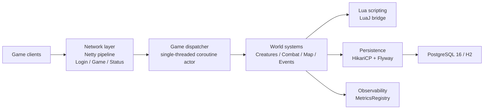

# Canary-Kotlin Architecture

> Adapted from canary/docs/architecture.md for the Kotlin/JVM engine.
> Canary-Kotlin status: rewritten for the Kotlin engine; the upstream conceptual
> sections (layering, hybrid core + Lua scripting, event-driven design,
> transactional persistence) are preserved and mapped to their Kotlin
> implementations.

## Overview

Canary Kotlin Edition is an MMORPG server emulator for Tibia-based games. It is
a port of the upstream Canary C++ engine (`../.projects/canary`) to **Kotlin
2.4.21** running on **Java 25 LTS**, with gameplay scripting left in **Lua**
executed by LuaJ.

The engine follows a layered architecture that separates networking, game
logic, persistence, scripting and tooling. The port preserves the upstream wire
contracts, formulas and Lua API surface while replacing the C++ runtime
mechanisms (`std::shared_ptr`, manual locks, singletons) with JVM equivalents
(dependency injection, coroutine confinement, GC-managed ownership).

---

# High-Level Architecture



---

# Core Architectural Principles

## 1. Layered Design

The port separates responsibilities into independent layers:

| Layer | Responsibility | Kotlin packages |
| --- | --- | --- |
| Network | Client communication | `network/` (`codec`, `connection`, `protocol`, `crypto`) |
| Game Engine | World simulation and rules | `game/`, `creatures/`, `combat/`, `map/`, `items/`, `spells/` |
| Scripting | Gameplay customization | `lua/` (`runtime`, `userdata`, `registry`, `bindings`, `loader`) |
| Persistence | Database operations | `database/`, `persistence/`, `io/` |
| Infrastructure | Configuration, metrics, logging, tooling | `config/`, `monitoring/`, `bootstrap/` |

Gameplay changes flow through Lua while the Kotlin core stays stable.

## 2. Kotlin Core + Lua Architecture

### Kotlin Core

The Kotlin engine handles:

- Networking
- Pathfinding
- Combat calculations
- Creature management
- Item management
- Map management
- Database access
- Scheduling and dispatch

### Lua Layer

Lua scripts provide:

- NPC behavior
- Quests
- Actions
- Movements
- Talkactions
- Spells
- Events
- Custom gameplay systems

The boundary is binding (AGENTS.md §1.4): Lua logic stays in `data/**/*.lua` and
is loaded through `Scripts`/`LuaEnvironment`; Kotlin only supplies the
C++-parity engine primitives those scripts call. The engine never re-authors a
Lua script as Kotlin.

## 3. Dependency Injection Instead of Singletons

The upstream engine relies on global accessors (`g_game()`, `g_dispatcher()`,
`g_configManager()`, `g_luaEnvironment()`, `g_metrics()`). The port removes them
in favor of constructor injection (AGENTS.md §1.1):

- `bootstrap/ServerBootstrap.kt` is the composition root. It builds the config
  manager, database pool, repositories, map, item/monster registries, Lua
  environment, dispatcher, game world and network listeners in dependency order.
- Domain seams are interfaces: `AccountRepository`, `PlayerStorageRepository`,
  `PersistentPlayerStorage`, `DatabaseBoot`, `ListenerBoot`, and similar
  contracts.
- Production implementations (`JdbcAccountRepository`, `JdbcPlayerRepository`,
  `DbPlayerStorageRepository`, HikariCP data sources) are bound at the
  composition root; tests bind in-memory implementations instead.

## 4. Single-Threaded World Confinement

All mutation of world entities (`Tile`, `Item`, `Creature`, `Player`) runs on the
`GameDispatcher`, a coroutine actor whose scope is
`Dispatchers.Default.limitedParallelism(1)` (AGENTS.md §1.2):

- Netty I/O workers never mutate world state directly. Inbound packets are
  handed to the dispatcher.
- Lanes (`DispatcherLane`) classify work: `ProtocolInput`, `PlayerWalk`,
  `PlayerAction`, `WorldCommit`, `WorkerCompletion`, `VisibleMonster`,
  `BackgroundMonster`, `VisibleMonsterAI`, `MonsterAI`, `Deferred`,
  `Maintenance`, `GenericParallel`.
- Serial lanes execute in order on the world thread; barrier-parallel lanes
  (`VisibleMonsterAI`, `MonsterAI`) may partition read-mostly work across
  workers and commit results back through `WorldCommit`/`Deferred`.
- No `synchronized` blocks or `ReentrantLock` protect world entities: state
  confinement replaces lock synchronization.

## 5. ByteBuf and Memory Lifecycle

- Inbound `ByteBuf` instances are released at handler boundaries
  (`ReferenceCountUtil.release`), never retained across the dispatcher boundary.
- Outbound frames use little-endian writes (`writeShortLE`, `writeIntLE`) to
  match the OpenTibia wire contract.
- Domain data is copied out of `ByteBuf` into immutable values (`Position`,
  value classes such as `Direction`) before crossing threads.

---

# Repository Structure

```text
canary-kotlin/
├── src/
│   ├── main/
│   │   ├── kotlin/org/opentibia/canary/
│   │   └── resources/db/migration/   # Flyway V1–V21
│   └── test/kotlin/org/opentibia/canary/
├── data/                             # Shared engine Lua resources
├── docs/
├── docker-compose.yml
├── Dockerfile
├── build.gradle.kts
└── settings.gradle.kts
```

---

# Source Code Architecture

## Main packages

```text
org.opentibia.canary/
├── account/       # Account model and repository contracts
├── bootstrap/     # DI composition root (ServerBootstrap)
├── chat/          # Channels and speech scopes
├── combat/        # Combat, damage, conditions
├── config/        # ConfigKeys, ConfigManager, environment loaders
├── creatures/     # Creature, Player, Monster, NPC, AI, spawning
├── database/      # HikariCP factory, JDBC repositories, tasks
├── economy/       # Player market and trade matching
├── game/          # Game world coordinator, scheduling (GameDispatcher)
├── io/            # OTBM/OTB/XML loaders, OTBM pipeline, appearances, I/O login data
├── items/         # Item, Container, world objects, XML parsing
├── kv/            # Key-value scopes persisted through the database
├── lib/           # Shared library ports (checksum, config helpers, ...)
├── lua/           # LuaJ runtime, userdata registry, bindings, loaders
├── map/           # Position, Tile, GameMap, MapGrid, spectators, cache
├── monitoring/    # MetricsRegistry
├── network/       # Netty server, codecs, connection, protocol handlers, crypto
├── persistence/   # Persistent player storage
├── protobuf/      # Generated appearance protobuf types
├── quest/, social/, spells/, systems/, utils/
```

---

# Game Engine

## Game coordinator

`game/Game.kt` coordinates the world:

- World state management
- Player tracking
- Creature tracking
- Event dispatching
- Combat orchestration
- Item management
- Map interaction

The upstream `Game` singleton becomes a constructor-injected object owned by the
composition root and reachable by the systems that need it. Conceptually:

```text
Game
 ├── Players
 ├── Monsters
 ├── NPCs
 ├── Items
 ├── Map (GameMap / MapGrid)
 ├── Events
 └── Lua environment
```

---

# Network Layer

Located under `network/` and built on Netty `ServerBootstrap`:

- `CanaryServer` owns the listener lifecycle, `NioEventLoopGroup` and channel
  groups for the login and game ports.
- The pipeline is `RateLimiterHandler` → `TibiaFrameDecoder` →
  `TibiaMessageEncoder` → protocol handler.
- `codec/` contains the framing, checksum and encryption stages (Adler-32,
  XTEA, RSA handshake).
- `protocol/` contains `LoginHandler`, `GameHandler`, `StatusHandler` and the
  modular `GamePacketRouter` handlers (`MovePacketHandler`,
  `ItemPacketHandler`, `CombatPacketHandler`, `LookPacketHandler`, ...).

Main protocols:

## ProtocolLogin

Handles:

- Authentication
- Character list retrieval
- Session initialization

## ProtocolGame

Handles:

- Movement
- Combat
- Chat
- Inventory updates
- World synchronization

## ProtocolStatus

Handles:

- Server status queries on the status port

---

# Creature System

Located under `creatures/`:

```text
Creature
├── Player
├── Monster
└── NPC
```

Shared functionality:

- Health
- Position
- Conditions
- Combat
- Movement

Specialized behavior is implemented by subclasses. Creature async work is
bucketed (`CreatureAsyncTaskBuckets`) so the dispatcher processes bounded
batches instead of unbounded per-creature tasks.

---

# Player Architecture

`Player` is the most complex entity in the port.

Responsibilities:

- Skills
- Experience
- Inventory
- Equipment
- Storage values
- Quests
- Achievements
- Cyclopedia data
- Character progression

Player data is loaded and saved through `io/iologindata` and the JDBC
repositories, inside `PlayerSaveTransaction`-bounded database work.

---

# Combat System

The combat subsystem (`combat/`) manages:

- Melee attacks
- Distance attacks
- Magic damage
- Healing
- Conditions
- Area effects

Flow:

```text
Attack
  ↓
Combat calculation
  ↓
Damage modifiers
  ↓
Condition processing
  ↓
Health update
  ↓
Client notification
```

---

# Map System

Located under `map/`:

- `Position` and `Direction` domain types
- `Tile` and tile item/creature stacks
- `GameMap` and `MapGrid` spatial storage (sector chunking)
- `Spectators` for visibility
- `AStarNodes` and pathing helpers
- `map/cache/` for the map cache, `MapDownload` and navigation snapshots
- `io/otbm/` for the binary OTBM parser and `io/pipeline/` for startup load
  orchestration

The map acts as the persistent world container. All mutations happen on the
dispatcher.

---

# Event System

The engine is event-driven. Examples:

- onLogin
- onLogout
- onThink
- onMove
- onUse
- onDeath
- onKill

Events are implemented in Lua through the LuaJ bridge (`LuaEventDispatcher`,
`lua/runtime`), enabling customization without recompiling Kotlin.

---

# Lua Scripting Engine

Located under:

```text
src/main/kotlin/org/opentibia/canary/lua/
data/
```

The bridge exposes Kotlin objects to scripts through Canary-named bindings and
userdata classes (`LuaEnvironment`, `Scripts`, `UserdataRegistry`,
`LuaClassRegistry`, `LuaScriptBridge`). Examples:

```lua
player:addItem()
player:addExperience()
creature:getHealth()
Game.getPlayers()
```

The scripting layer remains the primary extension point for custom servers, and
the Lua API surface is deliberately identical to upstream because the scripts
run unchanged (`docs/lua-api/`).

---

# Persistence Layer

Located under `database/`, `persistence/` and `io/`:

- `DatabaseConnectionFactory` builds HikariCP pools for PostgreSQL 16 or H2.
- `Jdbc*Repository` classes implement account, player, storage, depot, market,
  guild, kill, reward and VIP persistence.
- `persistence/` holds `PersistentPlayerStorage`/`PlayerData` for the
  runtime-facing storage contract.
- `io/iologindata` contains the player load/save paths.

Database operations are isolated from gameplay systems.

---

# Database Architecture

The port targets **PostgreSQL 16+** with **H2 in-memory in PostgreSQL mode** for
local runs and tests (AGENTS.md §2.1). There is no MariaDB/MySQL backend.

Schema definition:

```text
src/main/resources/db/migration/V1__initial_schema.sql ... V21__player_animus_mastery_column.sql
```

Flyway runs automatically on server boot before network traffic is accepted.
Schema changes are only made through new `V<version>__<description>.sql`
migrations; ad-hoc SQL is not allowed.

Main entities:

```text
accounts
players
guilds
houses
items
market
player_storage
player_skills
```

The database acts as the authoritative persistent state of the game world.

---

# Scheduler and Dispatcher

The port replaces the upstream Asio dispatcher with a coroutine actor.

## GameDispatcher

Handles:

- Queued game tasks (`dispatch`, `schedule`, `cycleEvent`)
- Lane classification and weighted deficit round-robin budgets
- Barrier-parallel monster AI work with bounded admission
- Worker completion hand-back
- Telemetry and adaptive budgets derived from the upstream dispatcher policy

## Scheduler

Handles:

- Delayed events and timers
- Creature thinking
- Regeneration

Flow:

```text
Incoming event
       ↓
Dispatcher lane queue
       ↓
World thread (or barrier partition)
       ↓
World mutation
       ↓
Lua callbacks + client output
```

This prevents race conditions and maintains world consistency: world mutation is
serialized even when monster AI work runs in parallel.

---

# Data Packs

## data/

Contains shared engine resources and reusable Lua systems loaded by the server:

- Actions
- Spells
- Quests
- Movements
- Talkactions
- Core libraries
- Shared event scripts

## data-canary/

Contains the lightweight Canary datapack used by the port. The upstream
`data-otservbr-global/` datapack is not selected by default in this repository.

---

# Metrics and Observability

Located under:

```text
src/main/kotlin/org/opentibia/canary/monitoring/
```

`MetricsRegistry` ports the upstream metrics surface: counters, up/down
counters, and latency histograms with the same bucket boundaries, rendered for
Prometheus-style scraping (`_total` counters, `gauge` up/down counters,
cumulative `_bucket`/`_sum`/`_count` histograms). The OpenTelemetry SDK,
HTTP exporter and OStream periodic reader are not ported.

Useful for:

- Server optimization
- Capacity planning
- Production monitoring

---

# Testing Architecture

Located under `src/test/kotlin/`:

- JUnit 5 + AssertJ + Mockk
- H2 in-memory (PostgreSQL mode) for persistence and migration tests
- Netty `EmbeddedChannel` for protocol tests without live sockets
- Transcript tests that mirror upstream C++ test cases

Purpose:

- Regression testing
- Engine validation
- Feature verification

`./gradlew test` is the gate: zero failures and zero compile warnings before any
commit or release claim (AGENTS.md §4).

---

# Docker Architecture

```text
┌──────────────────────────────┐
│ PostgreSQL 16 (alpine)       │
└───────────────┬──────────────┘
                │
┌───────────────▼──────────────┐
│ Canary Kotlin server         │
│ (built from Dockerfile)      │
└───────────────┬──────────────┘
                │
       7171 login/status, 7172 game
```

`docker-compose.yml` in the repository root builds the server from the
multi-stage `Dockerfile` (`gradle:9.8.1-jdk25` build stage,
`eclipse-temurin:25-jre-alpine` runtime stage) and starts PostgreSQL 16 with a
health check. There is no MyAAC or external login server in this stack; the
native login server on `7171` is the entry point.

---

# Build System

The port uses:

- Gradle 9.8.1 through the bundled wrapper (`./gradlew`)
- Kotlin JVM plugin 2.4.21 with `jvmToolchain(25)`
- The `application` plugin (`installDist` produces the runnable distribution)

Compilation flow:

```text
Gradle configuration
  ↓
Kotlin compilation (incremental)
  ↓
Resources + Flyway migrations
  ↓
Distribution in build/install/canary-kotlin
```

---

# Design Patterns Used

## Dependency Injection

Used for every former singleton:

- Config manager
- Database pool and repositories
- Dispatcher
- Game world
- Metrics

Purpose: explicit composition and testability at the `ServerBootstrap`
composition root.

## Component-Oriented Design

Player-related features are split into specialized modules under `systems/` and
component classes (`PlayerWheel`, `PlayerPvp`, proficiency, forge, bestiary,
and so on). This reduces coupling.

## Event-Driven Architecture

Most gameplay interactions are triggered by events. Benefits:

- Extensibility
- Scriptability
- Loose coupling

## Transaction-Based Persistence

Database writes are grouped into transactions (Flyway-managed schema,
`PlayerSaveTransaction`, batched repository calls). Benefits:

- Data consistency
- Safe player saves
- Reduced corruption risk

---

# Request Lifecycle

Example: player movement

```text
Client
  ↓
Netty pipeline (decode, decrypt)
  ↓
GamePacketRouter (MovePacketHandler)
  ↓
GameDispatcher (PlayerWalk)
  ↓
Game / Map validation
  ↓
Position update
  ↓
Lua events
  ↓
Client update
```

---

# Summary

Canary Kotlin Edition combines:

- A high-performance Kotlin/JVM engine on Java 25
- Flexible Lua scripting through LuaJ
- Event-driven gameplay
- Transactional persistence on PostgreSQL 16
- A modular, dependency-injected architecture

The result is a maintainable, testable platform for highly customized
Tibia-based game worlds with byte-level parity to the upstream engine.
